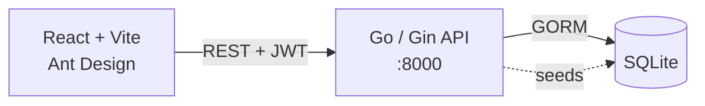

<div align="center">

# 🔐 Cybers

**A web puzzle game about cryptography. Break the code on each level to unlock the next one.**


</div>

---

## 📌 Overview

Cybers is a capture-the-flag style decoding game built to teach the basics of cryptography.
Players log in and work through **5 levels**. Each level hides an answer behind a different technique, from hashing to symmetric and asymmetric keys to a secret hidden inside an image.
Get it right and you move on. Finish them all and your name goes on the board.

## 🎮 Levels

| Level | Topic | Idea |
|---|---|---|
| 1 | 🧂 **Hash function** | Work with SHA hashes |
| 2 | 🔑 **Symmetric key** | Decrypt with a shared secret key |
| 3 | 🔑 **Symmetric key** (harder) | Classical cipher, e.g. Vigenère |
| 4 | 🗝️ **Asymmetric key** | Public / private key challenge, with clues hidden around the page |
| 5 | 🖼️ **Steganography** | The answer is hidden inside an image |
| 🏁 | **Final** | Completion screen with the latest players |

## ✨ Features

- 🔐 Sign up and sign in with bcrypt-hashed passwords and a JWT session
- 🧩 Challenges stored in the database (name, type, difficulty, order)
- ✅ Answers are submitted to the API and checked on the server
- 🏆 Final page that lists the latest players to finish
- 👤 Player profile management

## 🏗️ Architecture



## 🧰 Tech stack

- **Backend:** Go, Gin, GORM, SQLite, JWT, bcrypt
- **Frontend:** React 18, TypeScript, Vite, Ant Design, Axios

## 📁 Project structure

```
.
├── backend/
│   ├── config/            # DB setup + seed data (challenges, demo user)
│   ├── controller/ciper/  # get challenges, submit answers
│   ├── controller/users/  # auth + user CRUD
│   ├── entity/            # Users, Ciper, Answer, Genders
│   ├── middlewares/       # JWT authorization
│   └── main.go            # served on :8000
└── frontend/src/
    ├── pages/ciper/       # level1 … level5, final
    ├── pages/authentication/
    ├── routes/
    └── services/https/    # API client
```

## 🚀 Getting started

**Requirements:** Go 1.22+, Node.js 18+, and a C compiler for SQLite (gcc / MinGW).

```bash
# Backend → http://localhost:8000
cd backend
go run main.go
```

```bash
# Frontend → http://localhost:5173
cd frontend
npm install
npm run dev
```

A demo account is seeded on first run. See `backend/config/db.go`.

## 🔌 API

| Method | Endpoint | Description |
|---|---|---|
| `POST` | `/signup`, `/signin` | Auth |
| `GET` | `/ciper` | List challenges 🔒 |
| `POST` | `/ciper` | Submit an answer 🔒 |
| `GET/PUT/DELETE` | `/user/:id` | Player profile 🔒 |

🔒 needs an `Authorization: Bearer <token>` header.
